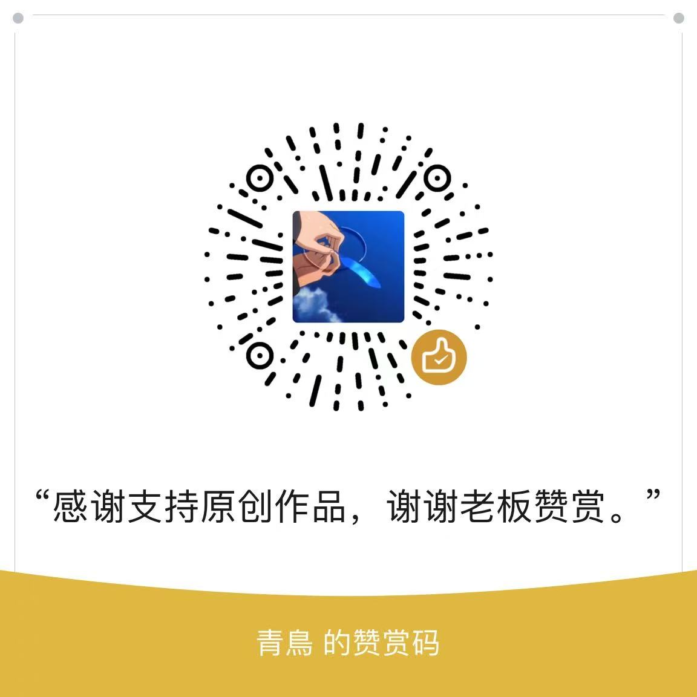

# Antigravity 一键汉化

> Google Antigravity（Agentic IDE）**Windows / macOS / Linux** 一键汉化工具
> **21030 翻译单元 · 双击即用 · 不装 Node.js 也能用 · 汉化本身全程本地（联网仅两处：npx 打包、手动「检查更新」，都可避开）· 永久免费**

<p align="center">
  <a href="https://github.com/QingniaoDawn/Antigravity-YiJianHanHua/releases/latest"></a>
  
  
</p>

---

## 下载（最新版 v1.21.1）

> 适配 **Antigravity 2.35.0**（2.31.x 继续可用）· 更新于 2026-11-25

| 你的系统 | 下载 | 启动方式 |
|---|---|---|
| **Windows** | **[下载 Windows 版](https://github.com/QingniaoDawn/Antigravity-YiJianHanHua/releases/latest)** | 解压 → 双击 `一键汉化.bat` |
| **macOS** | **[下载 macOS 版](https://github.com/QingniaoDawn/Antigravity-YiJianHanHua/releases/latest)** | 解压 → 右键 `一键汉化.command` → 选择「打开」 |
| **Linux** | **[下载 Linux 版](https://github.com/QingniaoDawn/Antigravity-YiJianHanHua/releases/latest)** | 解压 → 终端执行 `./一键汉化.sh`（已带可执行权限） |

- 更早版本的更新说明：[**Releases**](https://github.com/QingniaoDawn/Antigravity-YiJianHanHua/releases)（下面只列最近三个版本，完整历史都在 Releases 里）
- 每个 Release 都附 `SHA256SUMS.txt`；下载后可比对，程序内的「检查更新」也会自动校验
- **v1.21.1 主要变化**：补齐三处此前漏翻的界面。**模型选择器**：思考强度档位（`Extra High` / `Max` / `Minimal`）、档位说明、模型描述与「即将下线」标签；**配额面板**：`5h limit`、`Resets in 6d 20h` 这类运行时拼接的文案（用 6 条正则覆盖天/时/分的全部组合，并借引擎的时间归一化把 `2 hours, 5 minutes` 变成「2小时5分」）；**内置插件界面**：新增「智能体集群」等 sidecar 面板的汉化——这类面板是 `plugin://` 跨源 iframe，主引擎的 DOM 翻译够不到，改为直接改插件自己的 HTML/JS（首次修改前留 `.agyzhbak` 备份，选「恢复官方原版」可一键还原；官方更新插件会覆盖，重跑一次汉化即可恢复）
- **v1.21.0 主要变化**：适配 **Antigravity 2.35.0**。官方这版把会话列表改成了「收件箱（Inbox）」模式，插件权限界面做了整体重构，还新增了语音听写语言选择与七种文件预览器——这些新界面原来全是英文。本版补齐 **143 个翻译单元**（主词典 +120、前缀规则 +6、动态正则 +17），其中包含 Inbox 的右键菜单项（在当前/共享/新工作区继续、作为新对话继续）、权限确认按钮、听写语言、预览器类型、智能体状态与筛选错误提示。**权限确认按钮改为正则匹配**：2.35.0 不再用固定文案，而是运行时拼成 `Yes, allow downloads from <域名> for this run`，旧的精确匹配全部失效，现在用 11 条锚定正则覆盖各种组合。同时核对了引擎依赖的全部结构标识（正文隔离根、可编辑标题选择器、原生菜单挂钩点）在 2.35.0 中依然存在，**对话标题中文化补丁继续有效**（两段提示词各 1 处、214/238 字节未变）。`computer/hud.js` 已被官方删除（Mac 桌面悬浮控制条取消），对应 4 条锚点会自动跳过，属正常现象
- **v1.20.0 主要变化**：新增**对话名称与章节标题自动中文化**（社区建议来自 [PR #2](https://github.com/QingniaoDawn/Antigravity-YiJianHanHua/pull/2)）。左侧会话列表的自动命名、长对话的章节标题，是由后台 `resources/bin/language_server` 进程调云端模型总结的，它用的是自己硬编码的系统提示词、不读 `~/.gemini/config/rules/` 下的用户规则，而且原文把英文写死在里面（`3-5 words, title-cased` / `sentence case`），所以中文提问也只会得到英文标题。本版对这两段提示词做**字节数严格相等的替换**，改成要求输出简体中文标题：因为字节数完全一致，二进制里的段偏移、符号表、字符串长度全部原样不变，**不改变文件大小、零运行时开销**；实测替换前后 `--help` 输出逐字节一致。原版会自动备份成 `language_server.bak`（约 198 MB），「恢复原版」时一并回滚。**备份没做成就宁可不打这个补丁**——绝不会出现「改了却还原不回去」。**三平台都支持**；macOS 的 `language_server` 自带独立代码签名，改完会立刻 `codesign` 重签并验签，**签不上自动回滚**（这条链路尚未在 Mac 真机验证，出问题用菜单 `2` 回滚）

## 这是什么

[Antigravity](https://antigravity.google) 是 Google 出品的智能体编程 IDE，界面默认英文。
本工具把它完整变成简体中文——不需要懂命令行，不需要会编程：

- **双击 `一键汉化.bat`（Windows）/ `一键汉化.command`（macOS）/ 运行 `一键汉化.sh`（Linux）**，按数字选功能
- 官方更新后界面变回英文？**再双击一次，重新汉化就好**
- 想换回英文原版？**一键还原**，还原结果与官方原版字节级一致

## 直接使用仓库里的文件（不想下载 zip 的话）

仓库根目录就是完整工具，克隆或下载源码后同样能跑：

| 你的系统 | 用哪个 | 启动方式 |
|---|---|---|
| **Windows** | 仓库根目录的 `一键汉化.bat` | 双击即用 |
| **macOS** | [`mac/`](https://github.com/QingniaoDawn/Antigravity-YiJianHanHua/tree/main/mac) 目录 | 右键 `一键汉化.command` → 选择「打开」 |
| **Linux** | 仓库根目录的 `一键汉化.sh` 或 [`linux/`](https://github.com/QingniaoDawn/Antigravity-YiJianHanHua/tree/main/linux) 目录 | 终端执行 `./一键汉化.sh`（详见 [linux/README.md](https://github.com/QingniaoDawn/Antigravity-YiJianHanHua/blob/main/linux/README.md)） |

三个平台共用同一套引擎与词典（词条量、覆盖范围、备份策略完全一致），
`localize.py` 会自动识别当前系统走对应分支。

> macOS 用户请看 **[mac/README.md](https://github.com/QingniaoDawn/Antigravity-YiJianHanHua/blob/main/mac/README.md)**，里面讲清了代码签名这件事，
> 以及遇到「应用已损坏」怎么办。

## 为什么选这个

| 优势 | 说明 |
|---|---|
| **词条量天花板** | 21030 翻译单元（主词典 20602 + 前缀规则 92 + 核心词 117 + 动态正则 145 + 菜单映射 74），规模远超目前市面上的同类汉化方案 |
| **覆盖最全面** | 不只翻网页界面——原生菜单栏、**原生右键菜单**、系统托盘、系统弹窗、安装向导、权限确认弹窗、输入框提示、IDE 面板词条，**连内置插件面板（如「智能体集群」）也翻**，全都翻 |
| **三平台** | Windows、macOS、Linux 同一套脚本自动适配；macOS 版自动完成代码签名重签（Apple 官方推荐的分层方式），并写入稳定代码身份以保证官方应用内更新不被拒绝 |
| **真·一键** | 双击 → 数字菜单 → 完成。杀进程、备份、注入、校验、部署全自动，不需要敲任何命令 |
| **官方更新不怕** | 独创"备份防降级"设计：官方更新后重汉化，备份自动升级为新版官方原版——还原永远不会把你退回旧版本 |
| **安全干净** | 汉化全程本地操作，**零数据上传、零遥测**；不碰注册表/启动项/你的项目代码。只改两处：安装目录的 `app.asar`，以及 `~/.gemini` 下的插件界面文件（**均有备份，菜单 `2` 一键还原**）。联网只有两处且都透明：① 只有装了 Node.js 且走 `npx` 打包时，会从 npm 源取一次官方 asar 工具（约 3 MB，之后走本地缓存；**没装 Node.js 时直接用内置打包器，一次都不联网**）② 你主动点菜单 `5` 检查更新。写入前必做校验、部署后二次复检，任何一步不对就中止回滚 |
| **原子替换** | 部署用"临时文件 + 原子替换"，中途断电、强杀进程都不会留下半成品损坏安装 |
| **不误伤** | 身份守卫：装错目标（--path 指向其他软件）直接拒绝执行；杀进程按路径过滤，其他软件的同名进程不受影响 |
| **AI 回复也中文** | 界面汉化管不到 AI 生成的内容，本工具内置"AI 中文回复"规则开关（菜单 4），一键让 AI 用中文回答 |
| **可自己改词典** | 词典是明文 JSON 文件，想补充或修改词条，编辑 `zh_data.json` 后重跑即可 |

## 使用方法

### 环境要求

> [!IMPORTANT]
> **Node.js 是可选的，不装也能汉化。**
> v1.17.1 起工具会自动识别：
> - **装了且能正常启动** → 对改完的文件逐个跑 `node --check`，做**语法级**校验（最严格）
> - **没装，或装了但启动不起来** → 自动改用**结构自检**（注入块是否成对、文件是否完整），汉化照常完成
>
> v1.19.1 起「能不能启动」是**实测**的：只确认 PATH 里有这个名字不够——
> 有些机器残留着失效的 `node.cmd` 包装脚本或卸载后的执行别名，旧版会误判成可用，
> 然后**每个被修改的文件都报一次**「语法校验失败」，看着像工具坏了，其实原文件一个字节都没动。
>
> **两种情况下翻译内容完全一样**——Node.js 只负责"改完的代码语法对不对"这一步检查，
> 不参与翻译。区别只在「万一改坏了能不能当场发现」。
> **真正必需的是 Python 3.8+。**

**Windows：**

- Windows + 已安装 Antigravity（默认安装路径自动识别，装在别处可用 `--path` 指定）
- [Python](https://www.python.org/downloads/) 3.8+（安装时勾选 **Add Python to PATH**）—— **必需**
- [Node.js](https://nodejs.org) 18+ —— **可选**。装了会做语法级校验；
  没装则自动走结构自检。`npx` 也只用于官方 asar 工具，
  没有 Node.js 时直接用内置打包器（**全程离线**）

**macOS**（详见 [mac/README.md](https://github.com/QingniaoDawn/Antigravity-YiJianHanHua/blob/main/mac/README.md)）：

- macOS 12+ + 已安装 Antigravity
- Python 3.8+（`brew install python`）—— **必需**
- Node.js 18+（`brew install node`）—— **可选**，同上
- **Xcode 命令行工具**（`xcode-select --install`）——提供 `codesign`/`xattr`，
  没有它汉化后 App 会打不开，主程序会在汉化前明确报错

**Linux**（详见 [linux/README.md](https://github.com/QingniaoDawn/Antigravity-YiJianHanHua/blob/main/linux/README.md)）：

- Linux x86_64 + 已安装 Antigravity
- Python 3.8+（多数发行版自带；没有就用包管理器装）—— **必需**
- Node.js 18+ —— **可选**，同上
- 若 Antigravity 装在 `/opt` 或 `/usr/lib` 这类需要 root 的目录，
  脚本会在最后落盘那一步弹出 `sudo`/`pkexec` 授权（前面所有工序都在临时目录以普通用户完成）

### 操作菜单

Windows 双击 `一键汉化.bat`，macOS 右键 `一键汉化.command` →「打开」，
Linux 在终端执行 `./一键汉化.sh`：

| 选项 | 功能 |
|---|---|
| `1` 一键汉化 | 自动关进程 → 备份原版 → 注入汉化 → 校验 → 部署（macOS 追加自动重签名）→ 对话标题中文化（macOS 额外重签该二进制） |
| `2` 恢复官方英文原版 | 用备份一键还原，字节级与官方一致（对话标题补丁一并回滚） |
| `3` 查看状态 | 当前是否已汉化、备份是否完好、对话标题生成器状态（macOS 追加签名健康度） |
| `4` AI 回复中文化 | 写入一条全局规则，让 **AI 自己用中文回答**（思考过程仍英文，可随时关闭） |
| `5` 检查更新 | 查 GitHub 上有没有新版本；可选下载到桌面，**不会自动替换你现有的文件** |

也可以命令行调用：`python localize.py apply / restore / status / chinese-output / update`（macOS 用 `python3`）

### 关于「插件界面汉化」（会动 `~/.gemini`，请先看这段）

「智能体集群」这类**内置插件**不是网页界面，而是独立的小应用（sidecar），通过 `plugin://` 在隔离的 iframe 里加载。浏览器的同源策略让主界面的翻译引擎够不到它的文档，所以只能直接改插件自己的界面文件。

| 项目 | 说明 |
|---|---|
| **改哪里** | `~/.gemini/antigravity/builtin/plugins/<插件名>/sidecars/` 下的 HTML 与 JS |
| **改之前** | 每个文件先存一份同名 `.agyzhbak` 备份，备份成功才动原文件 |
| **怎么还原** | 菜单 `2`「恢复官方英文原版」会把它们一起还原，并删掉备份 |
| **官方更新后** | 插件更新会覆盖这些文件（界面变回英文），重跑一次汉化即可恢复 |
| **改了什么** | 只替换界面文字的字符串，不动任何逻辑；改完逐个做语法校验，不合格就回滚 |
| **没装这个插件** | 目录不存在时自动跳过，不会有任何副作用 |

> 目前**没有单独的开关**可以只汉化主界面、不动插件。如果你不希望任何文件被改动，请先不要运行本工具。

### 关于「检查更新」

- **默认不联网**：只有你主动选 `5`（或运行 `update`）时才会发一次请求，
  其余所有功能（汉化、还原、查看状态、AI 中文化）全程零网络行为。
- **只查不换**：请求的是 GitHub Release 元数据（版本号、更新说明、下载链接），
  不下载执行任何远端代码。就算你选了下载，也只是把 zip 存到桌面，
  **解压和替换由你自己决定**，本工具绝不动你现有的文件。
- **下不动有退路**：可以选「只要下载链接」，自己用浏览器或下载工具下。
- **查不到不影响使用**：网络不通、被限流时只会提示一句，不会报错卡住。
- **带 SHA256 校验**：若该版本的 Release 附带了 `SHA256SUMS.txt`，下载后会自动比对，
  不一致会明确告警，让你知道文件可能不完整或被掉包。

> **想让 AI 的回复也是中文？** 选 `4`。界面汉化管不了 AI 生成的内容，
> 正确做法是加一条"用简体中文回复"的全局规则（脚本已内置该功能）。

### 官方更新后怎么办

Antigravity 官方更新后界面会变回英文——这是正常现象，不是坏了。
**再运行一次选项 `1` 重新汉化即可**，备份会自动升级为新版官方原版。

**macOS 特别注意**：Mac 的更新组件在安装新版前会校验「当前 App 的代码身份」，
真正替换文件时还要靠 App 内的 `ShipIt` 安装器。重签时这两处会一并处理，
日志与「查看状态」会如实显示更新能力；如果显示不可用，请从官网下载新版覆盖安装，再重新汉化。
详细机制见 [mac/README.md](https://github.com/QingniaoDawn/Antigravity-YiJianHanHua/blob/main/mac/README.md#q重签名会不会影响我以后更新-antigravity)。

**可以连续操作**：每个操作做完会停一下让你看结果，按回车就回到主菜单，接着选下一项即可
（比如先「查看状态」再「一键汉化」，或者「汉化 → 恢复英文 → 再汉化」）。
窗口不会自己关掉；要关闭请点右上角的 ×，或者选 `0` 退出。
（macOS 上重签名也会一并重新完成）

## 汉化覆盖范围

- **网页界面**：侧边栏、对话流、设置全部子页、模型与用量、MCP 管理、权限沙盒、插件中心、远程控制、会话历史、IDE 面板（VS Code 侧词条）等
- **原生菜单**：顶部菜单栏（文件/编辑/视图/分屏/WSL 等 74 条）
- **原生右键菜单**：对话列表、消息气泡、选中文字、标签页，以及内置浏览器弹窗的剪切/复制/粘贴/全选/连接信息
- **系统托盘**：右键菜单、智能体运行计数
- **系统弹窗**：退出确认、更新检查、工作区选择、WSL 提示、连接信息安全提示等
- **安装向导**：欢迎页文案
- **权限确认弹窗**：一直允许 / 仅允许一次 / 拒绝 / 跳过 等全套按钮
- **对话标题与章节标题**：左侧会话列表的自动命名、长对话的章节标题改为**生成简体中文**（改的是后台语言服务器的提示词，不是翻译你已经有的标题，详见下一节）
- **提示文案**：placeholder / title / 悬浮提示（`aria-label` 刻意不翻——宿主拿它当稳定标识，翻了会让「取消」按钮误提交）

> 上表中 WSL 相关的 3 处弹窗是 **Windows 专属**，macOS 与 Linux 版本没有 WSL，
> 因此那几处在 Mac / Linux 上不会命中（脚本会明确说明"属正常现象"，不会报错）。
> 其余词条三平台通用。详见 [mac/README.md](https://github.com/QingniaoDawn/Antigravity-YiJianHanHua/blob/main/mac/README.md#与-windows-版的两点客观差异不是缺陷)。

### 版本适配

当前深度适配 **Antigravity v2.35.0**（离线全量验证 + 隔离副本端到端闭环：注入 / 重打包 / 还原 + 词典覆盖率审计；**Windows 上已有实际使用反馈**，模型选择器、配额面板、插件面板等界面已按用户截图逐项核对补齐；macOS / Linux 未做真机复测，如遇显示问题请提 Issue）。

| 版本 | 状态 |
|---|---|
| v2.35.0 | ✅ **当前基线**：129 处定点文案中 **125 处命中**、4 处因官方删除 `computer/hud.js` 自动跳过（官方把 Mac 桌面悬浮控制条移除了，属正常现象）；4 个挂钩点全部命中；注入 17 个文件、`node --check` 全通过；<br>重打包后 **1167 个文件里仅 17 个目标文件变更，其余 1150 个逐字节相同**；还原后 `app.asar` 精确回到官方 SHA-256；<br>补齐 **Inbox 收件箱**（含三处「继续」菜单项与设置说明）、**插件权限重构**、**语音听写语言**、**七种文件预览器**、智能体状态与筛选错误提示等 **143 个翻译单元**；<br>权限确认按钮改**正则匹配**——2.35.0 改为运行时拼接 `Yes, allow downloads from <域名> for this run`，旧的精确匹配全部失效；<br>核对引擎依赖的结构标识（`data-markdown-root` 12→13、可编辑标题选择器各 1 处、原生菜单挂钩点两处）全部仍在，**对话标题中文化补丁继续有效**（两段提示词各 1 处、214/238 字节未变） |
| v2.34.0 | ✅ 上一基线：133 处锚点全部命中（129 处定点文案 + 4 个挂钩点），注入 18 个文件、校验全通过；<br>补齐编排器设置、侧边栏筛选排序、输入框快捷键、内联卡片、HUD 的 Allow again 等 **101 条**新文案，修掉 11 条中英混杂；<br>修复对话正文被翻译：改用 `data-markdown-root` 做内容隔离，模型回复 / 计划清单 / 语音转录一律保持原文；<br>修复时长归一化把 `1M` 当 1 分钟的问题（单字母单位区分大小写 + 只在已翻译文本上生效）；<br>新增「相邻文本节点整句翻译」，修掉 React 拆句导致的「否 自动化 yet」这类半截译文 |
| v2.33.0 | ✅ 上一基线：132 处锚点全部命中（128 处定点文案 + 4 个挂钩点），注入 18 个文件、校验全通过；<br>补齐 SSH 远程、浏览器数据清理、快捷键设置页、侧问、麦克风与语音等 **206 条**前端文案 + **75 条**原生层文案，修掉 42 条中英混杂；<br>修 SSH 远程窗口右键菜单保持英文（`preload.js` 新增的 `isRemoteWindow` 分支单独包装）；还原时不再用旧备份覆盖新版本，避免 asar 与 exe 版本错配 |
| v2.31.x 及更早 | ✅ 均实测通过：2.31.x 跨 2.29.0 / 2.29.1 / 2.30.0 / 2.31.0 四个版本一次性补齐 **478 条**主包文案（语音模式、智能体集群、协调器、侧问 /btw、自动化改版、内置浏览器下载与证书页、快捷键自定义、Knowledge Work 布局、远程代理、订阅与授权码登录）；<br>v1.14 修掉「右键菜单整块保持英文」：原生菜单走 `window.electronNative.showContextMenu` → 主进程 `Menu.buildFromTemplate`，不产生 DOM，DOM 引擎根本看不到；<br>更早版本逐条收录了内置浏览器、PDF 查看器、附件、快捷键管理、云端项目、对话导航器、实时语音通话、应用连接等文案，累计数千条，明细见对应版本的 [Releases](https://github.com/QingniaoDawn/Antigravity-YiJianHanHua/releases) |
| 更高版本 | ⚠️ 通常仍可用：词典翻译走运行时 DOM 匹配，不依赖固定文件结构。<br>官方改名的新功能可能需要更新词典，跑一次选项 `1` 即可自动补上已收录的部分 |

界面翻译采用**运行时 DOM 文本匹配**，不修改官方界面文件本身。
因此官方更新不会破坏已有汉化，只可能新增少量未收录的新文案。

### 刻意保留英文的内容（设计共识，不是遗漏）

| 内容 | 原因 |
|---|---|
| AI 思考过程（Thinking） | 流式推理内容不适合词典翻译，强行翻会夹生卡顿；正文/总结/计划是中文 |
| 模型名（Gemini、Claude 等） | 产品名，翻译会造成识别混乱 |
| 个别受控下拉选项 | 翻译会导致组件状态失配、界面卡死，以"能用"优先 |
| 代码与代码块 | 程序代码不该被翻译 |
| 你输入的内容 | 输入区物理隔离，永远不会动你打的字 |
| 会话标题 / 项目名 / 侧问标签 | 这些是**你自己起的名字**（双击即可改名），翻译等于改你的数据；窗口标题同理，保持你原本写的语言。注意这条只管「翻译」，不管「生成」——模型新生成的标题走另一条路，见下一节 |

### 对话标题为什么会是英文，本工具怎么处理

左侧会话列表的「对话名称」和长对话的「章节标题」不是界面元素，而是后台
`resources/bin/language_server` 进程调云端模型**现场总结**出来的。它用的是自己内部
硬编码的提示词，不读 `~/.gemini/config/rules/` 里的用户规则，而且原文把英文写死在里面：

- 对话标题：`Respond with ONLY a short conversation title (3-5 words, title-cased, no prefix)`
- 章节标题：`Reply with only a plain 3 to 6 word title in sentence case, ...`

所以你全程用中文提问，标题照样是英文 Title Case。本工具把这两段提示词换成要求输出
简体中文的版本：两段原文分别是 214 和 238 字节，替换文本**一字节不差地保持同样长度**，
二进制里的段偏移、符号表、字符串长度头因此全部原样不变——文件大小不变、零运行时开销，
`--help` 输出与官方逐字节一致。

| 项目 | 说明 |
|---|---|
| 支持平台 | Windows、Linux、macOS（macOS 需要 `codesign`，见下行） |
| macOS | **支持，但多一道重签**。该二进制自带独立代码签名，改完必须立刻 `codesign` 重签并验签，**签不上会自动回滚到官方原版**；这条链路尚未在 Mac 真机跑过，出问题请用菜单 `2` 回滚 |
| 原版备份 | 同目录的 `language_server.bak`（约 198 MB），首次汉化时自动生成；尺寸一致时复用，不会每次重拷 |
| 还原 | 菜单选 `2` 恢复原版，与 `app.asar` 一起回滚 |
| 安全底线 | 备份没做成就**跳过这个补丁**，标题保持英文——绝不让你落到「改了却还原不回去」的状态 |
| 换版失效 | 官方改了提示词原文时，补丁会明确报「未命中」并保持英文，不报错、不影响界面汉化 |

> 只影响**新生成**的标题。你手动改过的标题、项目名、侧问标签一律不动——界面翻译引擎
> 仍然把那些位置整体排除在外。

## 自定义词典

所有词条都在 **`zh_data.json`** 一个文件里（明文 JSON）。想补充词条、改译法，直接编辑后重跑启动器即可，脚本会剥离旧翻译重新注入，不怕重复。

## 文件说明

| 文件 | 作用 |
|---|---|
| `一键汉化.bat` | Windows 双击入口（自动找 Python） |
| `localize.py` | 主程序：备份/注入/校验（node --check 或结构自检）/打包/部署/恢复/防并发/（macOS）代码签名重签 全流水线 |
| `engine.js` | 界面翻译引擎（注入到 Antigravity 内部运行） |
| `zh_data.json` | 词典数据（**21030 翻译单元**，另含 144 条内置插件界面文案；想补充词条改这个文件后重跑即可） |
| `mac/一键汉化.command` | macOS 双击入口（自动找 Python3 / codesign；Node.js 有就用、没有也行） |
| `mac/README.md` | macOS 专属说明与故障排查 |
| `一键汉化.sh` | Linux 终端入口（自动找 Python3；Node.js 有就用、没有也行） |
| `linux/README.md` | Linux 专属说明（路径探测、提权、`--no-kill` 热替换） |
| `赞赏码.jpg` | 打赏码（自愿打赏，不影响任何功能） |

## 注意事项

1. **杀毒软件可能误报**：修改其他程序的文件属于敏感行为，部分杀软会提示。本工具源码全部公开、可自行审查，添加信任/放行即可。
2. **运行前会自动关闭 Antigravity**：汉化和还原都需要先关闭应用，脚本会自动处理，不用手动关。
3. **备份文件别手动删**：安装目录里的 `app.asar.bak` 是还原用的官方原版备份，脚本会自动维护它。
   Windows / Linux 版还会在 `resources/bin/` 下生成 `language_server.bak`（约 **198 MB**，
   用于把对话标题生成器还原成官方版），同样别删——删了就没法单独回滚这一项（只能重装 Antigravity）。
4. **官方大版本更新后**：个别词条可能暂时失效（脚本会安全跳过，不报错不损坏），界面主体翻译不受影响；等本工具适配更新即可。
5. **支持 Windows、macOS 与 Linux**：Linux 版已补齐 `/proc/<pid>/exe` 精确进程识别、POSIX 原子热替换（`--no-kill`）、多安装路径自动探测与 `sudo`/`pkexec` 提权支持（详见 [linux/README.md](https://github.com/QingniaoDawn/Antigravity-YiJianHanHua/blob/main/linux/README.md)）。
6. **macOS 额外说明**：Mac 会对 `.app` 做代码签名，改包必然导致签名失效，
   本工具已在汉化/还原后自动重新签名（保留 Electron 运行必需的 entitlements），
   并写入稳定的代码身份，让官方应用内更新不被 Squirrel 拒绝
   （是否写入成功会在日志里明确显示，见 [mac/README.md](https://github.com/QingniaoDawn/Antigravity-YiJianHanHua/blob/main/mac/README.md)）。
   若弹出管理员密码框属正常流程；万一提示"应用已损坏"，见
   [mac/README.md](https://github.com/QingniaoDawn/Antigravity-YiJianHanHua/blob/main/mac/README.md#q汉化完提示应用已损坏无法打开) 的一键修复命令。
7. **本工具属于非官方第三方魔改**：介意"改动软件本体"的用户请勿使用；使用即表示了解并接受这一点。
8. **认准唯一下载渠道**：请只从本仓库 Release 页下载，其他渠道的打包可能被动手脚。
9. **解压路径别太深**：Windows 传统路径上限约 260 个字符，
   若把工具解压到类似 `D:\工作资料\编程工具\汉化\...` 这样的深层目录，
   可能因路径过长无法启动。**建议解压到 `D:\汉化工具\` 或桌面等较浅的位置。**
   这是 Windows 系统的限制，与本工具无关。
10. **双击 `一键汉化.bat` 满屏"不是内部或外部命令"**：这是批处理文件被存成了
   Unix 换行（LF）导致的，cmd 解析不了。v1.8 已把 `.bat` 改成 Windows 换行（CRLF），
   并把所有多行 `if (...)` 块改成单行 `goto`，以后再被编辑器存成 LF 也不会整段崩掉。
   如果你手上是旧版文件，重下 v1.8 即可。

## 常见问题

**Q：双击 `一键汉化.bat`，窗口一闪就没了 / 按任意键就闪退？**

v1.12 起的包不会再静默关窗：无论成功、出错还是中途取消，窗口都会停住并写明原因。
如果你手上是旧包，或者新版仍然遇到，按这个顺序查：

1. **先看窗口最底部有没有停住不动**。有，说明脚本已经跑完了，
   窗口是在等你按键确认，不是崩溃——往上翻就能看到它做了什么。
2. **看目录里有没有 `hanhua_error_log.txt`**。有就直接发给作者：里面记了系统版本、
   Python 版本、解释器路径和完整错误，不需要你再描述电脑环境。
   （这份日志会带上你的电脑用户名和安装路径，要公开发到论坛前先自己扫一眼。）
3. **想看完整报错**：在文件夹空白处按住 Shift 右键 →「在此处打开 PowerShell 窗口」，
   执行 `python localize.py`（找不到 python 就换 `py -3 localize.py`）。

> 注意：锁冲突（重复双击）和"你主动取消"不会生成这个日志，别去找它。

最常见的三个原因：

- 没装 Python，或安装时没勾 **Add Python to PATH**；
- Python 版本低于 3.8；
- 杀毒软件拦截了脚本（见「注意事项」第 1 条）。

> **Node.js 不在其中**：从 v1.17.1 起它已经是可选项，缺了不会中止，
> 工具会自动改用内置结构自检继续完成汉化。

> **启动脚本为什么是英文？**
> `一键汉化.bat` 刻意保持纯 ASCII，一行中文都不放。原因是 cmd 会按**控制台代码页**
> 解码 bat 文件：在英文版 Windows（代码页 437）下，GBK 汉字的第二个字节可能正好是
> `|` 或 `^`，cmd 会把它当管道/转义符，把整行截断后把后半截当命令执行——
> 实测会出现一堆 `xxx is not recognized as an internal or external command`。
> 所以 bat 只管启动和兜底，**所有中文提示都由 `localize.py` 输出**：
> Python 走 `WriteConsoleW` 宽字符通道，和代码页无关，中文版、英文版、UTF-8 模式
> 三种系统下都验证过，显示完全一致。

**Q：双击报 `'xxx' 不是内部或外部命令`？**
批处理文件被换行搞坏了（见「注意事项」第 10 条）。用最新版的包，
别用第三方编辑器改过 bat。

**Q：汉化完了界面还是英文？**
先跑选项 `3` 看状态是不是"已汉化"，再确认完全退出 Antigravity（含托盘图标）后重新打开。
运行时 DOM 翻译依赖界面加载完成，第一次打开稍等 1～2 秒。

**Q：卡在「正在重新打包 app.asar」并报 `npm error errno: 'EPERM'`？**
不是工具坏了，是那台机器的 **npm 缓存目录写不进去**。`npx` 在下载工具之前要先往缓存里
落临时文件，目录没权限就直接 `EPERM` 退出，还会甩一屏 npm 内部栈（典型现场：缓存被设到
`C:\某目录\node_cache`，而这个目录是管理员装的、或整个从别的账户拷过来的）。

工具现在会在开工前先探测一次缓存目录：写不进去就打印修复办法，并**自动改用内置打包器**
（带逐文件字节校验）把汉化做完，不再卡死。想让 `npx` 也恢复正常，在 **cmd** 里执行一次
（不需要管理员权限，缓存会搬回 npm 的默认位置）：

```bat
npm config set cache "%LOCALAPPDATA%\npm-cache"
```

⚠️ 这条别贴到 PowerShell：那里的 `%LOCALAPPDATA%` 不会展开，会存成一个无效路径。

## 安全声明

本工具可以接触你的 Antigravity 安装目录，安全底线如下（源码全部公开，欢迎自行审查）：

- **联网只有两处，都摆在明面上**：① 只有装了 Node.js 且走 `npx` 打包时，会从 npm 源取一次
  官方 asar 工具（约 3 MB，之后走本地缓存；**没装 Node.js 时直接用内置打包器，这一步完全本地**）；
  ② 菜单 `5`「检查更新」，只有你主动点它才会触发一次
  （只查版本号和下载链接，详见「关于『检查更新』」一节）。
  除此之外，汉化、还原、查看状态、AI 中文化全程无任何网络请求，不连任何服务器，
  无数据上报、无遥测、无"偷偷下载"。
- **只动该动的**：仅读写 Antigravity 安装目录内的文件；不碰注册表、系统服务、启动项、驱动，不碰你的项目代码和 Antigravity 用户数据
- **可完全还原**：一键还原到官方原版，字节级一致；备份永不降级（官方更新后自动升级备份）
- **坏不了**：写入前必做校验（有 Node.js 用 `node --check`，没有用结构自检），部署后二次解包复检，任一环节失败立即中止并回滚；部署采用原子替换，不存在"改到一半"的状态
- **不误伤别的软件**：身份守卫校验目标确实是 Antigravity 才动手；杀进程只杀 Antigravity 安装目录下的进程（macOS 按完整可执行路径精确匹配；Linux 读 `/proc/<pid>/exe` 内核符号链接比对真实路径；Windows 按可执行文件路径比对 —— 三平台都绝不误杀同名程序）
- **macOS 签名如实告知**：改包会破坏 Apple 代码签名，本工具自动重签并校验；
  重签用的是临时签名而非 Google 官方签名，不影响官方更新（更新后重跑一次即可）
- **输入内容绝对安全**：输入框、代码区、思考链物理隔离，词典翻译永远触碰不到你输入和生成的内容

## 免责声明

1. 本工具为**独立第三方工具**，与 Google、Antigravity 官方没有任何关联，也未经官方认可。
2. 本工具按"现状"提供，**不附带任何明示或默示的担保**。因使用或无法使用本工具导致的任何问题（包括但不限于软件异常、数据丢失、需要重装软件、**账号或服务受限等后果**），均由使用者自行承担。
3. 是否使用由你决定——修改软件本体属于个人学习研究行为，请自行评估风险并遵守当地法律法规及软件服务条款。
4. 请通过本仓库官方 Release 页获取本工具，从其他渠道获取的副本安全性与本作者无关。

## 支持作者

本工具**永久免费**。如果它确实帮到了你，欢迎扫码打赏，金额随意。

**打赏完全是自愿的**——不打赏也能正常使用全部功能，没有任何区别，
不会弹窗、不会提示、不会限制任何功能。



## 免费声明

本工具**永久免费**，不设付费版、不设会员，打赏为自愿行为而非使用条件。

**任何收费售卖本工具的行为都是倒卖，请拒绝并向平台举报；不幸付费购买的，可向售卖者要求退款。**

## 版权与授权

Copyright (c) 2026 青鸟（QingniaoDawn）· 详见 [LICENSE](LICENSE)

- 允许个人学习、自用，以及在**完整保留本声明和作者署名**的前提下免费分享原包
- **禁止商用、倒卖、收费分发**，禁止去除署名或冒充原创
