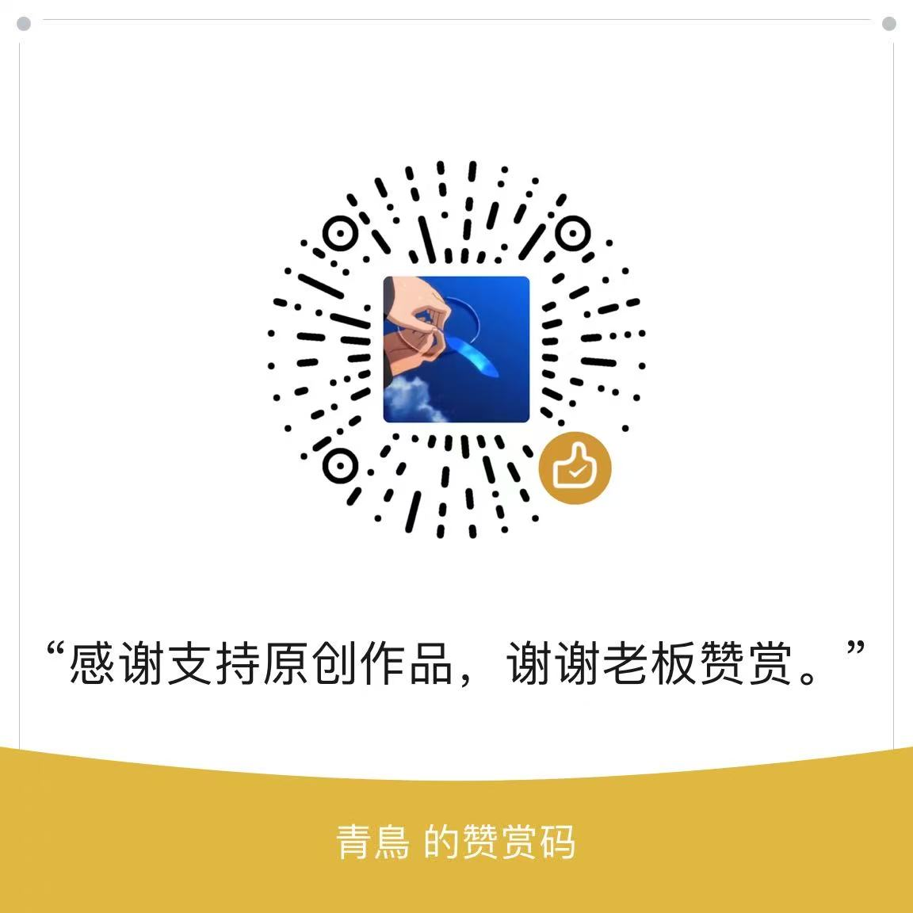

# Antigravity 一键汉化

> Google Antigravity（Agentic IDE）**Windows / macOS** 一键汉化工具
> **19956 翻译单元 · 双击即用 · 汉化零联网（唯一联网：手动检查更新）· 永久免费**

---

## 这是什么

[Antigravity](https://antigravity.google) 是 Google 出品的智能体编程 IDE，界面默认英文。
本工具把它完整变成简体中文——不需要懂命令行，不需要会编程：

- **双击 `一键汉化.bat`（Windows）/ `一键汉化.command`（macOS）**，按数字选功能
- 官方更新后界面变回英文？**再双击一次，重新汉化就好**
- 想换回英文原版？**一键还原**，还原结果与官方原版字节级一致

## 先看你是什么系统

| 你的系统 | 用哪个 | 启动方式 |
|---|---|---|
| **Windows** | 仓库根目录的 `一键汉化.bat` | 双击即用 |
| **macOS** | [`mac/`](mac/) 目录 | 右键 `一键汉化.command` → 选择「打开」 |

两个平台共用同一套引擎与词典（词条量、覆盖范围、备份策略完全一致），
`localize.py` 会自动识别当前系统走对应分支。

> macOS 用户请看 **[mac/README.md](mac/README.md)**，里面讲清了代码签名这件事，
> 以及遇到「应用已损坏」怎么办。

## 为什么选这个

| 优势 | 说明 |
|---|---|
| **词条量天花板** | 19956 翻译单元（主词典 19605 + 前缀规则 86 + 核心词 117 + 动态正则 74 + 菜单映射 74），规模远超目前市面上的同类汉化方案 |
| **覆盖最全面** | 不只翻网页界面——原生菜单栏、系统托盘、系统弹窗、安装向导、权限确认弹窗、输入框提示、IDE 面板词条，全都翻 |
| **双平台** | Windows 与 macOS 同一套脚本自动适配；macOS 版自动完成代码签名重签（Apple 官方推荐的分层方式） |
| **真·一键** | 双击 → 数字菜单 → 完成。杀进程、备份、注入、校验、部署全自动，不需要敲任何命令 |
| **官方更新不怕** | 独创"备份防降级"设计：官方更新后重汉化，备份自动升级为新版官方原版——还原永远不会把你退回旧版本 |
| **安全干净** | 汉化全程本地操作，**零联网、零数据上传、零遥测**（唯一例外：你主动点菜单 `5` 检查更新时才连一次 GitHub）；写入前语法门禁、部署后二次复检，任何一步不对就中止回滚 |
| **原子替换** | 部署用"临时文件 + 原子替换"，中途断电、强杀进程都不会留下半成品损坏安装 |
| **不误伤** | 身份守卫：装错目标（--path 指向其他软件）直接拒绝执行；杀进程按路径过滤，其他软件的同名进程不受影响 |
| **AI 回复也中文** | 界面汉化管不到 AI 生成的内容，本工具内置"AI 中文回复"规则开关（菜单 4），一键让 AI 用中文回答 |
| **可自己改词典** | 词典是明文 JSON 文件，想补充或修改词条，编辑 `zh_data.json` 后重跑即可 |

## 使用方法

### 环境要求

**Windows：**

- Windows + 已安装 Antigravity（默认安装路径自动识别，装在别处可用 `--path` 指定）
- [Python](https://www.python.org/downloads/) 3.8+（安装时勾选 **Add Python to PATH**）
- [Node.js](https://nodejs.org) 18+（解包/打包安装包用）

**macOS**（详见 [mac/README.md](mac/README.md)）：

- macOS 12+ + 已安装 Antigravity
- Python 3.8+（`brew install python`）
- Node.js 18+（`brew install node`）
- **Xcode 命令行工具**（`xcode-select --install`）——提供 `codesign`/`xattr`，
  没有它汉化后 App 会打不开，主程序会在汉化前明确报错

### 操作菜单

Windows 双击 `一键汉化.bat`，macOS 右键 `一键汉化.command` →「打开」：

| 选项 | 功能 |
|---|---|
| `1` 一键汉化 | 自动关进程 → 备份原版 → 注入汉化 → 校验 → 部署（macOS 追加自动重签名） |
| `2` 恢复官方英文原版 | 用备份一键还原，字节级与官方一致 |
| `3` 查看状态 | 当前是否已汉化、备份是否完好（macOS 追加签名健康度） |
| `4` AI 回复中文化 | 写入一条全局规则，让 **AI 自己用中文回答**（思考过程仍英文，可随时关闭） |
| `5` 检查更新 | 查 GitHub 上有没有新版本；可选下载到桌面，**不会自动替换你现有的文件** |

也可以命令行调用：`python localize.py apply / restore / status / chinese-output / update`（macOS 用 `python3`）

### 关于「检查更新」

- **默认不联网**：只有你主动选 `5`（或运行 `update`）时才会发一次请求，
  其余所有功能（汉化、还原、查看状态、AI 中文化）全程零网络行为。
- **只查不换**：请求的是 GitHub Release 元数据（版本号、更新说明、下载链接），
  不下载执行任何远端代码。就算你选了下载，也只是把 zip 存到桌面，
  **解压和替换由你自己决定**，本工具绝不动你现有的文件。
- **下不动有退路**：可以选「只要下载链接」，自己用浏览器或下载工具下。
- **查不到不影响使用**：网络不通、被限流时只会提示一句，不会报错卡住。
- **带 SHA256 校验**：若该版本的 Release 附带了 `SHA256SUMS.txt`，下载后会自动比对，
  不一致会明确告警，让你知道文件可能不完整或被掉包。

> **想让 AI 的回复也是中文？** 选 `4`。界面汉化管不了 AI 生成的内容，
> 正确做法是加一条"用简体中文回复"的全局规则（脚本已内置该功能）。

### 官方更新后怎么办

Antigravity 官方更新后界面会变回英文——这是正常现象，不是坏了。
**再运行一次选项 `1` 重新汉化即可**，备份会自动升级为新版官方原版。

**可以连续操作**：每个操作做完会停一下让你看结果，按回车就回到主菜单，接着选下一项即可
（比如先「查看状态」再「一键汉化」，或者「汉化 → 恢复英文 → 再汉化」）。
窗口不会自己关掉；要关闭请点右上角的 ×，或者选 `0` 退出。
（macOS 上重签名也会一并重新完成）

## 汉化覆盖范围

- **网页界面**：侧边栏、对话流、设置全部子页、模型与用量、MCP 管理、权限沙盒、插件中心、远程控制、会话历史、IDE 面板（VS Code 侧词条）等
- **原生菜单**：顶部菜单栏（文件/编辑/视图/分屏/WSL 等 74 条）
- **系统托盘**：右键菜单、智能体运行计数
- **系统弹窗**：退出确认、更新检查、工作区选择、WSL 提示等
- **安装向导**：欢迎页文案
- **权限确认弹窗**：一直允许 / 仅允许一次 / 拒绝 / 跳过 等全套按钮
- **输入框提示**：placeholder / aria-label 提示文案（不触碰输入内容本身）

> 上表中 WSL 相关的 3 处弹窗是 **Windows 专属**，macOS 版本没有 WSL，
> 因此那几处在 Mac 上不会命中（脚本会明确说明"属正常现象"，不会报错）。
> 其余词条两平台通用。详见 [mac/README.md](mac/README.md#与-windows-版的两点客观差异不是缺陷)。

### 版本适配

当前深度适配 **Antigravity v2.28.1**（Windows 真机验证）。

| 版本 | 状态 |
|---|---|
| v2.28.1 | ✅ **当前基线**，深度适配：24 处静态锚点全部命中，注入 10 个文件语法门禁通过； 连同 2.28.0 一起补齐 97 条文案（内置浏览器、PDF 查看器、任意类型附件、快捷键管理、云端项目与 GitHub 集成、对话导航器）； v1.10 又补 145 条（提示卡碎片、扩展市场全量文案、模型公告与配额动态文案） |
| v2.27.0 | ✅ 上一基线，24 处静态锚点全部命中，真机实测通过； 收录该版新增 231 条文案（云端工作区、实时语音通话、应用连接、账号切换、远程控制实例等） |
| v2.25.0 | ✅ 上一基线，20 处静态锚点 + 3 处挂钩点全部命中，真机实测通过； 收录该版新增 31 条 + 中英混杂修复 13 条 + **存量公开文案补全 136 条** |
| v2.24.0 | ✅ 深度适配通过（上一基线，20 处锚点 + 3 处挂钩全部命中）；收录该版新增 97 条 + 历史补漏 1 条 |
| v2.23.1 | ✅ 深度适配通过（更早基线，20 处锚点 + 3 处挂钩全部命中） |
| v2.22.0 / v2.23.0 | ✅ 实测通过（已同步收录两版新增的 UI 词条） |
| v2.21.1 | ✅ 深度适配通过（更早基线，词典向后兼容） |
| v2.18.1 及更早 | ✅ 实测通过（词典向后兼容） |
| 更高版本 | ⚠️ 通常仍可用：词典翻译走运行时 DOM 匹配，不依赖固定文件结构。 官方改名的新功能可能需要更新词典，跑一次选项 `1` 即可自动补上已收录的部分 |

界面翻译采用**运行时 DOM 文本匹配**，不修改官方界面文件本身。
因此官方更新不会破坏已有汉化，只可能新增少量未收录的新文案。

**v1.10 补漏（2026-10-30）**：上一版发出去后，把界面逐页扫了一遍（不是只扫打包文件，
而是把运行中的应用当审计对象，逐页读 DOM），补掉三类漏翻和两类引擎隐患：

1. **被图标切断的句子碎片**：提示卡里的 `in the top left.` / `menu)` 这类片段，
   因为中间夹着图标，整句永远匹配不上，于是永远显示英文（或半中半英）。
   这次按「前半句 + 图标 + 后半句」的实际渲染顺序分别给译文，拼起来才是通顺中文。
2. **扩展市场的分类与服务端文案**：7 个分类名与说明、11 张内置卡片说明、
   50 个合作方插件的完整介绍、页脚免责声明，全部补齐。
   插件**名称**保持英文原样（Browserbase、Stripe 这类产品名硬翻反而找不到东西），
   「See 18 more」改成「再显示 18 个」。
3. **模型选择器的公告**：`Notice` / `Unavailable` 徽章，以及悬停后的整段公告
   （含 `starting on November 2, 2026` 这种带日期的句子）——这类文案是服务端下发的，
   每次上线都可能变，所以走**动态规则**而不是死记硬背。

引擎这一轮补了两件事：

- **日期与时长归一**：译文里残留的 `November 2, 2026` 会变成 `2026年11月2日`，
  配额提示里的 `Resets in 3h54m47s` 会变成 `3小时54分47秒后重置`。
- **多词串的链接保护**：原来只保护「单个词 + 技术符号」，实测
  `See [go/jetski-agent-sidecars#trusted-locations](…)` 这种两段式串会把链接里的
  `jetski-agent` 替成 `jetski-智能体`，**点开会 404**。现在整串含 URL / 文件名 / 锚点时一律原样返回。

另外顺手修掉两个坑：

- **从 Electron 系终端启动会「假失败」**：VS Code / WorkBuddy 这类终端会给子进程带上
  `ELECTRON_RUN_AS_NODE=1`，Antigravity 继承后会被当成 Node 解释器——不弹窗、立刻退出 0。
  以前只在日志里报「启动失败」，现在启动前会主动剔除这个变量。
- **两条会把整段塞进短词的前缀规则**：它们让技能说明变成
  「中文半句 + 英文整段」的拼接怪，已删除，改用完整精确词条覆盖。

覆盖率（同一套 2466 条候选口径）：**2123 条 → 2164 条，86.1% → 87.8%**。
剩下 291 条全英文的都是内部开关名、代码常量、错误信息这类不该翻的内容。

**v2.28.1 新增内容的处理**：这次跨了两个版本（2.27.0 → 2.28.0 → 2.28.1），共补 97 条文案：

- **内置浏览器**（2.28.0 的头号功能）：`Built-in Browser` / `External Browser` / `Side Panel` / `Side Panel Preview`、
  `Open Links In` / `Open in` / `Open in Side Panel`、地址栏安全指示 `Not secure` / `Your connection to this site is not secure`、
  证书面板 `Certificate details` / `Certificate is valid` / `Issued by` / `The certificate has been revoked.`、
  `View site information`，以及设置页的两段说明文字。
- **PDF 查看器与附件**：`File size exceeds 20MB limit` / `Failed to attach file`。
- **快捷键管理**：`Add Shortcut` / `Edit Shortcut` / `Remove Shortcut` / `Reset All to Defaults`、
  `Search shortcuts...` / `Press keys...` / `No keyboard shortcuts found matching your filter.`、
  `Middle Click`、浏览器标签页占用快捷键的提示。
- **对话导航与标签页**：`Move Conversation Up` / `Move Conversation Down` / `Open Conversation in New Tab` / `Reopen Closed Tab`。
- **云端项目与 GitHub 集成**：`Cloud Projects` / `Cloud only` / `Local only` / `Local Checkout`、
  `Connect GitHub…` / `Loading repositories…` / `No repositories found` / `Requires a GitHub repository`、
  `Worktree Branches` / `View Branches` / `Not cloned locally`。
- **数据删除**：`Remote Agents Data` / `Delete All Data` / `Delete All Remote Agents Data?` 及整段说明。
- **插件与市场**：`More Plugins` / `Permission Details` / `Website` / `Sign in needed`、`Explore other marketplace customizations`。
- **主题与字体**：`Enable New Themes` 及两项实验性外观设置说明。
- **对话状态**：`Waiting for your approval`。

主词典由 19363 条增至 **19460 条**（词典版本 1.9.0）。本次一起做了四件事：

1. **修掉一个会让汉化直接失败的官方包问题**：2.28.1 的 `app.asar` 索引里声明
   `node_modules/chrome-devtools-mcp/.../selectElementAccessibility…Descendant.md` 是外部文件（unpacked），
   但 `app.asar.unpacked` 目录下实际没有这个文件——官方打包漏了一个（1085 个条目里坏 1 个）。
   标准 asar 工具遇到「索引里有、文件却没有」的条目会整体报错退出，汉化在解包阶段就中止。
   现在工具内置了一个容错解包器：官方工具失败时自动接管，逐条处理、跳过缺失项并明确提示。
   跳过的文件本来就读不到，跳过不改变运行行为。
   打包后的完整性守卫也同步排除这 1 个条目——否则**「再跑一次汉化」会误报中止**
   （参照官方备份时发现缺这一项）。这个坑是实测踩到才发现的，两条入口都验证过：
   从官方原版跑、从已汉化状态重跑，产物字节完全一致。
2. **修掉 22 条中英混杂**：核心词表会把没被精确收录的新词逐词硬替换，产出
   `删除 All Data`、`添加 Shortcut`、`Cloud 项目`、`Empty 日志` 这类半截货，比纯英文更难受。
   这批全部补了精确词条，实测中英混杂从 49 条降到 9 条（剩下的是 GitHub / Google Sans / Chrome
   这类专有名词保留，属正常译法）。
3. **引擎加了技术串保护**（`engine.js` 的核心词分词环节）：原来 `\b` 词边界在 `/` `.` `-` `:` 旁边也算边界，
   会把 `https://policies.google.com/privacy` 里的词、`show-more` 这类连字符标识符一起替换掉，
   产出坏 URL 和坏标识符——这比不翻更危险。现在「无空格且含技术符号」的串直接原样返回。
   用 25006 条样本做新旧引擎对照：**误伤 0 条**，39 条译文由混杂变干净，51 条从不翻变成翻。
4. **旧词条一律保留，不删**：还在用旧版本的用户不受影响。

**v2.27.0 新增内容的处理（上一版）**：这一版跨度较大，界面新增了一整批功能，对应文案全部补齐（231 条）：

- **云端工作区**：项目文件和对话附件存在 Google 服务器、挂载到云端沙箱、连接 Google Drive / GitHub 资源、
  数据留存与删除说明、`Resume environment` / `Resuming environment…` / `This chat's environment is paused`。
- **实时语音通话**（Live Chat）：开始 / 结束、麦克风静音、语音音量、上一个 / 下一个声音、输入消息、拖放附件。
- **应用连接**：`Connected apps` / `On this computer` 两个标签页、只登录一次即可跨设备使用、应用市场里连接应用。
- **插件替换**：`Currently installed` / `Replace with` / `Replacing...` 及替换确认正文。
- **多账号**：账号标签页、切换失败、`Add label` / `Used for:` / 设为默认的引导句。
- **远程控制**：`Remote Control Instances` / `No instances yet.` / `Get started with Remote Control`。
- **浏览器右键菜单**：在新标签页打开链接 / 在外部浏览器打开 / 复制链接地址 / 打开图片 / 复制图片地址。
- **过滤与状态**：`Only Archived` / `Only Automations` / `Only Scheduled`、`Toggle Status Bar`、`Fit Mode`。
- **连接状态**：`Connecting…` / `Still connecting…` / `Reconnecting…` / `reconnecting`。

上一版主词典由 19137 条增至 19363 条（词典版本 1.8.0）。同一批还做了四件事：

1. **修复启动方式**（用户实测报的问题）：以前选 `Y` 立即启动，Antigravity 会和本工具共用同一个控制台——
   它的日志（DevTools 端口、`wsl.exe` 报错、自动更新）直接刷满窗口，关窗口时还会顺手把 Antigravity 一起关掉，
   工具退出后窗口也不关，看起来像"输 0 没反应"。现在改成独立进程启动（`DETACHED_PROCESS` + 三路流转 NUL），
   日志不再串台，关工具窗口不影响 Antigravity。
2. **退出提示不再骗人**：操作结束处的提示写着"输入 0 可退出"，实际代码只把输入丢掉、照样回主菜单。
   现在真按提示执行。
3. **旧词条一律保留，不删**：2.27.0 有一批旧文案不再出现在前端包里
   （例如 `Start voice` / `End voice` 被 Live Chat 系列取代）。
   这些老词条留在词典里既不会误翻、也不占运行时开销，保留是为了向后兼容旧版本，
   方便还在用 2.24 / 2.25 的用户。
4. **修掉 5 条历史错译**（这轮深度审计挖出来的）：`ID` 曾被译成"标题"、`URL` 译成"文件"、
   `PID` 译成"内存(MB)"、`For` 译成"适用源"、`uv` 译成"UV 包管理器"，
   都是早期合并上游词典时串行的。这几个是界面表头/状态字段，译错会让用户看到**错误信息**。
   缩写类（ID / URL / PID / uv）直接删条目保持英文——中文界面本来也写 ID、URL；
   `App` 则从"应用设置"改正为"应用"。

**这一版的覆盖率是怎么算的（可以自己复核）**：把 2.28.1 的真实界面包逐条提取，
得到 2466 条候选文案，用内置引擎实跑一遍：**2123 条已翻译（86.1%）**（v1.10 补漏后为 2164 条 / 87.8%）。
剩下 343 条的构成是——产品名与厂商名（GitHub、Windows、Linux、macOS、Drive、Google3、Gemini Enterprise）、
模型名（`Flash Lite` / `Flash` / `Pro`）、内部日志前缀（`[AppState]`、`[TrajectorySummaries]`、
`[McpServerStates]` 等）、示例占位值（`Workspace_1`、`http://localhost:8080`、`my-gcp-project`）、
命令标识符（`run_command` / `view_file`）、LaTeX 渲染命令（`\fbox` / `\angl`），
另有 17 条路径与内部短链、5 条枚举常量、字体名与按键名各 1 条。
**这些刻意不翻**：翻协议错误串会破坏 MCP 通信，翻示例占位符会误导用户填错值，
翻模型名会让人认不出是哪个模型，翻 `ID`/`URL` 反而让人看不懂。它们不是"漏掉"，是"不该动"。

**v2.25.0 新增内容的处理**：这一版是小版本，主打插件侧边栏徽标、窗口快捷键与可靠性修复，
界面文案增量不大，但有两块是全新的：**语音模式**（语音模式开关、语音引擎与地址配置、
开始语音 / 结束语音 / 静音麦克风 / 取消静音、语音已开启、语音已断开、
麦克风被阻止、语音启动失败等提示）和**插件与账户管理**
（启用插件后才能登录、启用后才能管理账号、添加多账号时 MCP 服务器使用标记为默认的那个、
无需登录、重新登录、设为默认、显示或隐藏插件、在侧边栏中显示、打开插件页 / 技能页），
另外补上状态栏的语言服务器渠道与版本提示、磁盘已满搜索受限提示、`Checking…` / `Custom…` 等状态文案，
共 31 条新文案。

同批还修掉了 13 条**中英混杂**的老问题——这些词条此前没有精确译文，被核心词表逐词替换成了
「执行 Identity」「打开 plugin page」「显示 in Sidebar」这类半截输出。现已全部补齐整句译文，
主词典由 18957 条增至 19001 条。

随后又做了一轮**存量补全**：把此前版本一直没收录的 136 条公开界面文案一次补齐
（插件包管理、账号与登录、工件预览、终端、GitHub 策略、轨迹统计、引导页等），
v1.7 发布时主词典为 **19137 条**（v1.8 增至 19363 条、v1.9 增至 19460 条、v1.10 增至 19605 条，见上）。

**v1.7 里的一个安全修复**：审计时发现 Antigravity 会把 `aria-label` 当作稳定标识使用
（例如某个输入框失焦时用 `aria-label === "Cancel"` 判断是否点了「取消」）。
此前引擎会翻译 `aria-label`，一旦译成「取消」，该判断失效——点取消反而会提交内容。
现已把 `aria-label` 移出翻译范围：它是给读屏软件的标识，不是可见文案，不翻不影响界面观感。

**v1.7 里的另外三处修复**（都是这轮深度审计挖出来的）：

1. **macOS「检查更新」菜单项点击失效**：官方代码用 `updateActions[menuItem.label]` 查动作表，
   键是英文；标签被翻成「检查更新」后查不到，点击静默无反应。现在保留英文原值用于查表，
   显示仍用译文；更新状态变化时也不会再变回英文。
2. **17 条词条错位**：英文讲的是 A，中文写的却是完全无关的 B
   （例如 `Model: {0}` 被写成「选择模型」、`Jetski Update Available` 被机翻成「摩托艇更新可用」）。
   这些是早期从上游词典合并时串行的历史遗留，本版逐条改正，并新增占位符一致性门禁防复发。
   （补充说明：经全安装目录比对，这些词条在 2.25.0 界面中并未被引用，属当前版本用不到的历史条目；
   本次修正属词典准确性维护，不会改变可见界面。）
3. 相同译文重复、`${...}` 占位符被改错等情况一并纳入发布前自动检查。

**此前的 v2.24.0** 重做了侧边栏并加入概览面板，新增 `/compact` 对话压缩、自动化任务可选模型、
侧边栏「自动置顶」、项目 / 工作区独立排序、登录过期提示、按对话关闭遥测、
「每次响应的 Harness」与成本统计、时间轴缩放提示、三类权限标签等 97 条文案；
**v2.22.0 / v2.23.0** 加入的侧边栏拖拽整理、UI 扩展、消息框权限预设选择器、
全屏媒体查看器、`.zip` 附件、MCP「让智能体修复」、参谋长（Chief of Staff）等词条同样保留，向后兼容。

**官方更新后想补充新词条**：打开 `zh_data.json`，在 `exact` 段加一行
`"英文原文": "中文翻译"`，重新运行汉化即可。

### 刻意保留英文的内容（设计共识，不是遗漏）

| 内容 | 原因 |
|---|---|
| AI 思考过程（Thinking） | 流式推理内容不适合词典翻译，强行翻会夹生卡顿；正文/总结/计划是中文 |
| 模型名（Gemini、Claude 等） | 产品名，翻译会造成识别混乱 |
| 个别受控下拉选项 | 翻译会导致组件状态失配、界面卡死，以"能用"优先 |
| 代码与代码块 | 程序代码不该被翻译 |
| 你输入的内容 | 输入区物理隔离，永远不会动你打的字 |

## 自定义词典

所有词条都在 **`zh_data.json`** 一个文件里（明文 JSON）。想补充词条、改译法，直接编辑后重跑启动器即可，脚本会剥离旧翻译重新注入，不怕重复。

## 文件说明

| 文件 | 作用 |
|---|---|
| `一键汉化.bat` | Windows 双击入口（自动找 Python） |
| `localize.py` | 主程序：备份/注入/语法门禁/打包/部署/恢复/防并发/（macOS）代码签名重签 全流水线 |
| `engine.js` | 界面翻译引擎（注入到 Antigravity 内部运行） |
| `zh_data.json` | 词典数据（**19956 翻译单元**，想补充词条改这个文件后重跑即可） |
| `mac/一键汉化.command` | macOS 双击入口（自动找 Python3 / Node.js / codesign） |
| `mac/README.md` | macOS 专属说明与故障排查 |
| `赞赏码.jpg` | 打赏码（自愿打赏，不影响任何功能） |

## 注意事项

1. **杀毒软件可能误报**：修改其他程序的文件属于敏感行为，部分杀软会提示。本工具源码全部公开、可自行审查，添加信任/放行即可。
2. **运行前会自动关闭 Antigravity**：汉化和还原都需要先关闭应用，脚本会自动处理，不用手动关。
3. **备份文件别手动删**：安装目录里的 `app.asar.bak` 是还原用的官方原版备份，脚本会自动维护它。
4. **官方大版本更新后**：个别词条可能暂时失效（脚本会安全跳过，不报错不损坏），界面主体翻译不受影响；等本工具适配更新即可。
5. **支持 Windows 与 macOS**；Linux 暂不适用（脚本已预留分支，未做真机适配）。
6. **macOS 额外说明**：Mac 会对 `.app` 做代码签名，改包必然导致签名失效，
   本工具已在汉化/还原后自动重新签名（并保留 Electron 运行必需的 entitlements）。
   若弹出管理员密码框属正常流程；万一提示"应用已损坏"，见
   [mac/README.md](mac/README.md#q汉化完提示应用已损坏无法打开) 的一键修复命令。
7. **本工具属于非官方第三方魔改**：介意"改动软件本体"的用户请勿使用；使用即表示了解并接受这一点。
8. **认准唯一下载渠道**：请只从本仓库 Release 页下载，其他渠道的打包可能被动手脚。
9. **解压路径别太深**：Windows 传统路径上限约 260 个字符，
   若把工具解压到类似 `D:\工作资料\编程工具\汉化\...` 这样的深层目录，
   可能因路径过长无法启动。**建议解压到 `D:\汉化工具\` 或桌面等较浅的位置。**
   这是 Windows 系统的限制，与本工具无关。
10. **双击 `一键汉化.bat` 满屏"不是内部或外部命令"**：这是批处理文件被存成了
   Unix 换行（LF）导致的，cmd 解析不了。v1.8 已把 `.bat` 改成 Windows 换行（CRLF），
   并把所有多行 `if (...)` 块改成单行 `goto`，以后再被编辑器存成 LF 也不会整段崩掉。
   如果你手上是旧版文件，重下 v1.8 即可。

## 常见问题

**Q：双击 `一键汉化.bat` 窗口一闪就没了？**
说明启动脚本本身出错了。在文件夹空白处按住 Shift 右键 →「在此处打开 PowerShell 窗口」，
然后执行 `python localize.py`，能看到完整报错。最常见的原因是没装 Python 或没勾 "Add Python to PATH"。

**Q：双击报 `'xxx' 不是内部或外部命令`？**
批处理文件被换行搞坏了（见「注意事项」第 10 条）。用 v1.8 的包，别用第三方编辑器改过的 bat。

**Q：汉化完了界面还是英文？**
先跑选项 `3` 看状态是不是"已汉化"，再确认完全退出 Antigravity（含托盘图标）后重新打开。
运行时 DOM 翻译依赖界面加载完成，第一次打开稍等 1～2 秒。

## 安全声明

本工具可以接触你的 Antigravity 安装目录，安全底线如下（源码全部公开，欢迎自行审查）：

- **零联网**：汉化、还原、查看状态、AI 中文化全程无任何网络请求，不连任何服务器，无数据上报、无遥测、无"偷偷下载"。
  唯一的联网入口是菜单 `5`「检查更新」，且只有你主动点它才会触发一次
  （只查版本号和下载链接，详见「关于『检查更新』」一节）
- **只动该动的**：仅读写 Antigravity 安装目录内的文件；不碰注册表、系统服务、启动项、驱动，不碰你的项目代码和 Antigravity 用户数据
- **可完全还原**：一键还原到官方原版，字节级一致；备份永不降级（官方更新后自动升级备份）
- **坏不了**：写入前语法门禁校验，部署后二次解包复检，任一环节失败立即中止并回滚；部署采用原子替换，不存在"改到一半"的状态
- **不误伤别的软件**：身份守卫校验目标确实是 Antigravity 才动手；杀进程只杀 Antigravity 安装目录下的进程（macOS 按完整可执行路径精确匹配，绝不误杀同名程序）
- **macOS 签名如实告知**：改包会破坏 Apple 代码签名，本工具自动重签并校验；
  重签用的是临时签名而非 Google 官方签名，不影响官方更新（更新后重跑一次即可）
- **输入内容绝对安全**：输入框、代码区、思考链物理隔离，词典翻译永远触碰不到你输入和生成的内容

## 免责声明

1. 本工具为**独立第三方工具**，与 Google、Antigravity 官方没有任何关联，也未经官方认可。
2. 本工具按"现状"提供，**不附带任何明示或默示的担保**。因使用或无法使用本工具导致的任何问题（包括但不限于软件异常、数据丢失、需要重装软件、**账号或服务受限等后果**），均由使用者自行承担。
3. 是否使用由你决定——修改软件本体属于个人学习研究行为，请自行评估风险并遵守当地法律法规及软件服务条款。
4. 请通过本仓库官方 Release 页获取本工具，从其他渠道获取的副本安全性与本作者无关。

## 支持作者

本工具**永久免费**。如果它确实帮到了你，欢迎扫码打赏，金额随意。

**打赏完全是自愿的**——不打赏也能正常使用全部功能，没有任何区别，
不会弹窗、不会提示、不会限制任何功能。

## 免费声明

本工具**永久免费**，不设付费版、不设会员，打赏为自愿行为而非使用条件。

**任何收费售卖本工具的行为都是倒卖，请拒绝并向平台举报；不幸付费购买的，可向售卖者要求退款。**

## 版权与授权

Copyright (c) 2026 青鸟（QingniaoDawn）· 详见 [LICENSE](LICENSE)

- 允许个人学习、自用，以及在**完整保留本声明和作者署名**的前提下免费分享原包
- **禁止商用、倒卖、收费分发**，禁止去除署名或冒充原创
